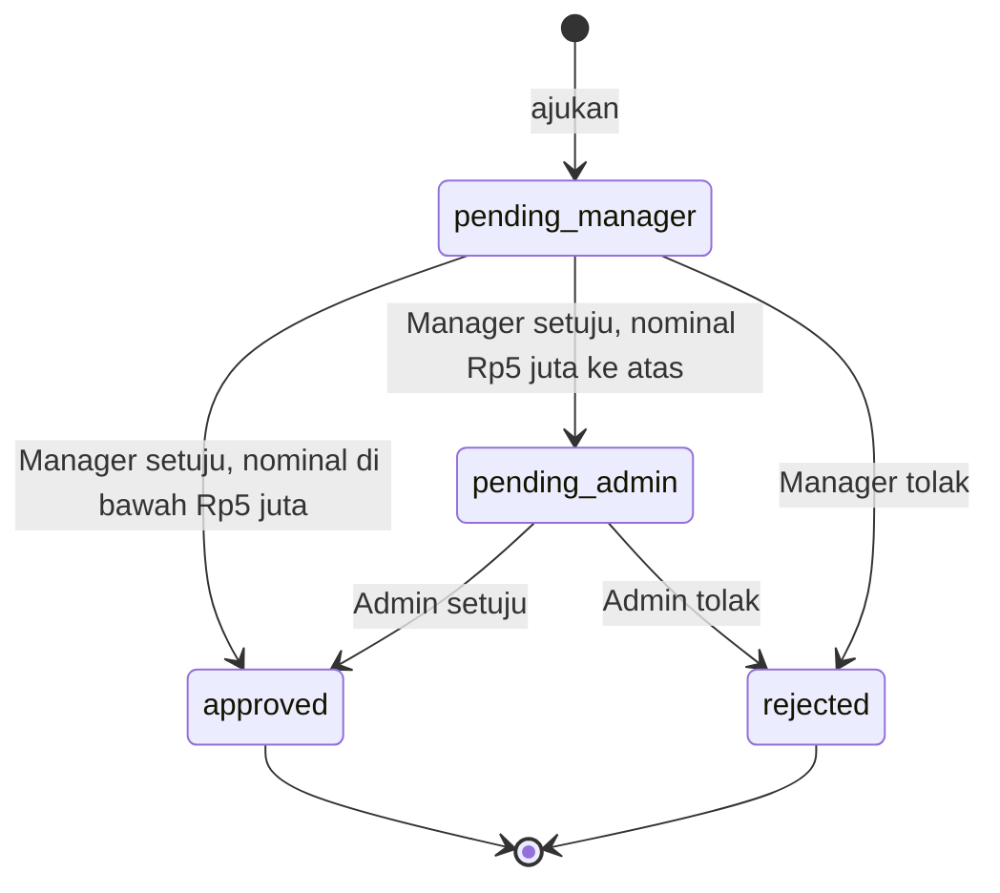

# OpsCore

Portal operasional internal untuk perusahaan yang masih memakai spreadsheet: pengajuan pembelian dengan persetujuan berjenjang, pelacakan aset dan mutasi stok, hak akses per peran, audit log, dan kode QR untuk setiap aset.

**Demo langsung:** https://arilsaputra854.github.io/opscore/

Demo berisi 330 baris data contoh (150 aset, 120 mutasi stok, 60 pengajuan) dari seeder deterministik, sehingga tabel langsung terisi saat dibuka.

## Yang bisa dicoba di demo

- Ganti peran lewat menu "Masuk sebagai": Staff, Manager, Admin. Menu dan tombol tetap terlihat, tetapi tindakan yang tidak diizinkan ditolak dengan pesan jelas.
- Ajukan pembelian. Di bawah Rp5.000.000 cukup disetujui Manager. Rp5.000.000 ke atas harus disetujui Manager lalu Admin.
- Catat mutasi stok masuk atau keluar (Manager dan Admin). Stok keluar tidak boleh melebihi stok.
- Buka Audit log (Manager dan Admin) untuk melihat siapa mengubah apa, dari status apa ke status apa.
- Buat kode QR untuk aset mana pun.

## Matriks hak akses

| Izin | Staff | Manager | Admin |
|---|:-:|:-:|:-:|
| Melihat aset dan stok | ya | ya | ya |
| Mengajukan pembelian | ya | ya | ya |
| Menyetujui tingkat 1 | tidak | ya | ya |
| Menyetujui tingkat 2 | tidak | tidak | ya |
| Mencatat mutasi stok | tidak | ya | ya |
| Membaca audit log | tidak | ya | ya |

## Alur persetujuan



Setiap transisi menulis satu baris audit: waktu, pelaku, aksi, target, status asal dan tujuan.

## Demo vs produksi

| Bagian | Demo ini | Versi produksi |
|---|---|---|
| Aturan RBAC dan persetujuan | Kode asli di `src/core.js` | Aturan yang sama, ditegakkan di server |
| Autentikasi | Pilihan peran di menu (tanpa login) | Login dan sesi |
| Data | Memori browser, hilang saat dimuat ulang | PostgreSQL atau MySQL, seeder untuk 300+ baris |
| Framework | JavaScript murni | Laravel (Livewire atau Inertia), atau React dengan Node |

Penting: di demo, pemeriksaan izin berjalan di browser sehingga tidak aman sebagai kontrol akses nyata. Di produksi, setiap izin diperiksa ulang di server.

## Menjalankan lokal

```bash
git clone https://github.com/Arilsaputra854/opscore.git
cd opscore
npx serve .          # buka http://localhost:3000
npm test             # 5 test: seeder, matriks izin, rantai persetujuan, mutasi stok
```

## Struktur

```
index.html, style.css, app.js   antarmuka portal
src/core.js                     seeder, izin, mesin persetujuan, mutasi stok, audit
test/core.test.mjs              test
DESIGN.md                       arah desain dan alasannya
```

## Lisensi

MIT. Lihat [LICENSE](LICENSE).
